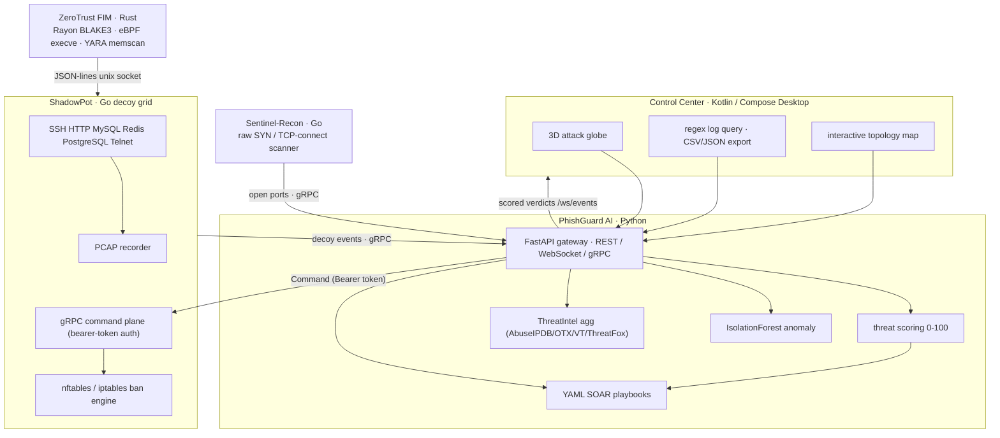

<div align="center">

# AegisX

### Multi-Language Autonomous XDR / SOAR Platform

[](https://github.com/cokovali10-sketch/AegisX-/actions)
[](LICENSE)
[](sentinel-recon/)
[](phishguard/)
[-stable-DEA584?logo=rust&logoColor=white)](zerotrust-fim/)
[](control-center/)
[](proto/)
[](#)

Unifying raw-socket network scanning, multi-protocol deception decoys, zero-trust file integrity monitoring with kernel-level exec tracing, AI-driven threat intelligence, and automated mitigation playbooks — all speaking a single gRPC/Protobuf contract.

> **Legal:** AegisX is a *defensive* toolset. Scan and decoy only networks and systems you own or are explicitly authorized to test.

</div>

---

## Highlights

| Module | Stack | Capabilities |
|--------|-------|-------------|
| **Sentinel-Recon** | Go | Raw-socket SYN + TCP-connect scanning, adaptive RTT/loss pacing, exponential-backoff throttling, watermark alerting, IPv4/IPv6 checksums, banner grabbing |
| **ShadowPot** | Go | Six-protocol decoy grid (SSH, HTTP, MySQL, Redis, PostgreSQL, Telnet), dependency-free PCAP writer, automated nftables/iptables IP-ban engine, token-authenticated gRPC command plane |
| **ZeroTrust FIM** | Rust | Rayon-parallel BLAKE3 file integrity monitoring, SQLite baseline, in-kernel `sys_enter_execve` eBPF tracing (with `/proc` fallback), YARA process-memory scanning, anomaly heuristics |
| **PhishGuard AI** | Python | FastAPI + gRPC gateway, explainable 0–100 threat scoring, multi-feed OSINT aggregation (AbuseIPDB/OTX/VirusTotal/ThreatFox), IsolationForest ML anomaly detection, YAML SOAR playbooks with safe expression evaluator |
| **Control Center** | Kotlin | Compose Desktop dashboard: 3D attack globe, live regex log query with CSV/JSON export, interactive topology map |
| **Single IDL** | Protobuf | One `aegisx.proto` compiled to Go, Python and Kotlin bindings; four gRPC services |

---

## Architecture



### Layer Overview

| Layer | Language | Responsibility |
|-------|----------|---------------|
| `sentinel-recon` | Go | Raw-socket SYN + TCP-connect scanning, adaptive RTT/loss pacing, banner grabbing, JSON/protobuf export |
| `shadowpot` | Go | SSH / HTTP / MySQL / Redis / PostgreSQL / Telnet decoys, PCAP recording, automated IP banning, SOAR command plane |
| `zerotrust-fim` | Rust | Rayon-parallel BLAKE3 FIM, SQLite baseline, eBPF `sys_enter_execve` tracing, YARA process-memory scanner, Unix-socket IPC |
| `phishguard` | Python | Threat scoring, OSINT aggregation, IsolationForest anomaly detection, YAML SOAR playbooks, gRPC gateway, Prometheus metrics |
| `control-center` | Kotlin | Compose Desktop: 3D attack globe, real-time regex log query, interactive topology map, live feed |
| `proto/` | Protobuf | Single IDL: `AegisX`, `ThreatIntelService`, `eBPFStreamer`, `SOARPlaybookService` |

---

## Quick Start (Docker)

```bash
# 1. Configure (optional keys left blank are skipped)
cp .env.example .env

# 2. Build + start every service
docker compose up -d --build

# 3. Verify
curl http://localhost:8080/health
curl http://localhost:8080/metrics | head

# 4. Test: hit the SSH decoy with a credential attempt
ssh -p 2222 root@127.0.0.1        # wait BAN_THRESHOLD → auto-ban

# 5. Watch the live feed
#    open http://localhost:8080/ws/events (or connect the Control Center)
```

### On-demand Scanner

```bash
docker compose --profile recon up sentinel-recon
```

---

## Manual Builds

Bindings are committed — a fresh clone builds without `protoc`. Regenerate only after editing `proto/aegisx.proto`.

### Proto Bindings

```bash
make proto                                  # Linux/macOS
powershell -File scripts/gen-proto.ps1      # Windows
```

### Sentinel-Recon (Go)

```bash
cd sentinel-recon
go build -o bin/aegisx-recon ./cmd/aegisx-recon

# SYN scan (needs CAP_NET_RAW / root):
./bin/aegisx-recon -target scanme.example.com -mode syn -start 1 -end 1024 -maxpps 2000

# TCP-connect (no privileges):
./bin/aegisx-recon -target scanme.example.com -start 1 -end 1024 -banners
```

### ShadowPot (Go)

```bash
cd shadowpot
go build -o bin/aegisx-shadowpot ./cmd/aegisx-shadowpot

SHADOWPOT_GRPC_UPSTREAM=127.0.0.1:50051 \
SHADOWPOT_GRPC_LISTEN=":50053" \
SHADOWPOT_BAN_BACKEND=journal \
./bin/aegisx-shadowpot
```

### ZeroTrust FIM (Rust)

```bash
cd zerotrust-fim
cargo build --release
target/release/aegisx-fim --watch /etc --baseline /var/lib/aegisx/fim-baseline.db \
  --socket /var/run/aegisx-fim.sock --threads 0 --trace-exec

# Advanced (Linux only):
cargo build --release --features ebpf   # aya sys_enter_execve (CAP_BPF)
cargo build --release --features yara   # YARA memscan (CAP_SYS_PTRACE)
```

### PhishGuard AI (Python)

```bash
cd phishguard
python -m venv .venv
source .venv/bin/activate
pip install -r requirements.txt

AEGISX_SHADOWPOT_GRPC=shadowpot:50053 \
PYTHONPATH=".:../proto/gen/python" \
python -m uvicorn app.main:app --host 0.0.0.0 --port 8080
```

### Control Center (Kotlin)

```bash
cd control-center
./gradlew run
```

---

## End-to-End Demo

```bash
AEGISX_SHADOWPOT_TOKEN="$(openssl rand -hex 32)" docker compose up -d --build
python scripts/demo-attack.py --json --out demo-summary.json
cat demo-summary.json
```

The demo script drives the full closed loop: streams a 9-event attacker campaign, runs a SOAR playbook that dispatches a firewall block, proves unauthenticated mitigation is rejected, then accepts the authenticated one.

---

## Testing

| Suite | Command | Scope |
|-------|---------|-------|
| Go: scanner | `cd sentinel-recon && go test ./...` | Pacer, RTT/loss adaptation, checksums, watermark, IPv6 |
| Go: shadowpot | `cd shadowpot && go test ./...` | Event bus, IP-ban engine, command plane, PCAP, listener utils |
| Python | `cd phishguard && python -m pytest -q` | ML anomaly, safe-eval, threat-intel, scoring (32 tests) |
| Rust | `cd zerotrust-fim && cargo test --all-features` | Exec classification, `/proc` tab parsing |
| E2E | `python scripts/verify-scoring.py` | Offline scoring-path smoke |

---

## Configuration

Copy `.env.example` → `.env` and edit. All variables have sane defaults.

| Variable | Default | Purpose |
|----------|---------|---------|
| `PHISHGUARD_HTTP_PORT` | `8080` | Web UI / REST / WebSocket |
| `PHISHGUARD_GRPC_PORT` | `50051` | Decoy + recon gRPC intake |
| `DECOY_SSH_PORT` | `2222` | SSH honeypot |
| `DECOY_MYSQL_PORT` | `3306` | MySQL honeypot |
| `DECOY_REDIS_PORT` | `6379` | Redis honeypot |
| `DECOY_POSTGRES_PORT` | `5432` | PostgreSQL honeypot |
| `DECOY_TELNET_PORT` | `23` | Telnet honeypot |
| `SHADOWPOT_GRPC_PORT` | `50053` | SOAR command plane |
| `AEGISX_SHADOWPOT_TOKEN` | *(empty)* | Bearer token for command plane auth |
| `BAN_THRESHOLD` | `3` | Events before auto-ban |
| `BAN_WINDOW_SECONDS` | `300` | Sliding detection window |
| `BAN_DURATION_SECONDS` | `3600` | Ban lifetime |
| `BAN_BACKEND` | `auto` | `auto` / `nftables` / `iptables` / `journal` |
| `FIM_WATCH_DIR` | `/etc` | Protected directory |
| `ABUSEIPDB_KEY` | *(empty)* | AbuseIPDB API key |
| `VT_KEY` | *(empty)* | VirusTotal API key |
| `PROMETHEUS_PORT` | `9090` | Prometheus UI |

---

## Observability

PhishGuard exposes Prometheus metrics at `/metrics`:

```bash
curl -s http://localhost:8080/metrics | grep aegisx_
```

Key series: `aegisx_grpc_events_total{protocol}`, `aegisx_grpc_verdicts_total`, `aegisx_soar_playbooks_run_total{playbook}`, `aegisx_soar_firewall_blocks_issued_total`

```bash
docker compose --profile observability up -d prometheus   # UI: http://localhost:9090
```

---

## Runtime Ports

| Service | Port | Purpose |
|---------|------|---------|
| PhishGuard HTTP/WS | 8080 | REST + `/ws/events` + `/metrics` |
| PhishGuard gRPC | 50051 | Decoy / recon telemetry intake |
| ShadowPot SSH / MySQL / Redis / PostgreSQL / Telnet | 2222 / 3306 / 6379 / 5432 / 23 | Decoys |
| ShadowPot gRPC command plane | 50053 | SOAR firewall enforcement |
| Prometheus | 9090 | Metrics UI |

---

## Security

- **Command plane auth** — bearer token with constant-time comparison; empty token = dev mode
- **No secrets in repo** — all API keys injected via environment
- **Firewall enforcement** — bans apply nftables/iptables rules with `CAP_NET_ADMIN`
- **Defensive only** — see legal note above

---

## Troubleshooting

| Symptom | Fix |
|---------|-----|
| Docker privilege errors | Confirm `cap_add`/`privileged` support; remove `sentinel-recon` profile if raw-socket blocked |
| `go test` fails with missing `aegisx/proto` | Generated bindings in `proto/gen/` — run `make proto` only after editing `.proto` |
| FIM won't attach eBPF | Need Linux + `CAP_BPF`/`CAP_PERFMON` + tracefs; use `--trace-exec` fallback |
| PhishGuard ignores OSINT | Set `ABUSEIPDB_KEY` / `VT_KEY`; missing keys are skipped silently |
| No firewall bans | Check `SHADOWPOT_BAN_BACKEND=journal` and ensure 3+ events within window |

---

## Roadmap

- [x] Unified `ThreatEvent` bus + command router
- [x] Coverage-guided fuzzing with IDOR + JWT forgery
- [x] AI honeynet with honeytoken watermarking
- [x] Static analysis with risk scoring
- [x] 3D console with Panic Mode
- [ ] Real-time kernel blocklist propagation (eBPF map sync)
- [ ] NATS-backed event fan-out
- [ ] Threat-intel enrichment (MISP/OpenCTI)
- [ ] SOC playbook automation

---

## License

[Apache License 2.0](LICENSE)
